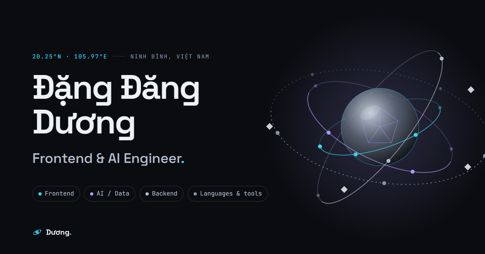

# Digital Orbit — Đặng Đăng Dương

Personal portfolio of **Đặng Đăng Dương**, Frontend & AI engineer (Information Computer Engineering, VNU-IS · Ninh Bình, Việt Nam).

The hero is an interactive 3D object generated from real content: **the core is the main specialty, each ring is a skill group, each node is a skill, each satellite is a project**. The section break is a Tràng An karst skyline over water.



## Highlights

- **Data-driven 3D hero**: vanilla three.js in a lazy chunk, loaded after `load` + idle, only while the hero is on screen. Rings draw in, nodes appear, satellites launch from the core. A comet makes one pass for the work experience.
- **Interaction**: damped mouse follow, hover a ring to isolate it, click to jump to that skill group. The DOM chips under the object stay in sync with the rings.
- **Fallbacks**: a static, data-driven SVG of the same orbit is used for reduced motion, no WebGL, Save-Data, low-power devices, and automatically when the frame rate stays too low.
- **Prerendered HTML**: all content is readable with JavaScript disabled, and the `h1` is the LCP element painted straight from HTML.
- **Hide-when-empty**: any section without data disappears from the page *and* the navigation.
- **Personal details**: a live Ninh Bình clock next to the coordinates (status dot = waking hours), the Journey section drawn as a climbing route whose rope uncovers on scroll, and project cards with a subtle pointer tilt + glare (fine pointers only).
- **Quick actions**: `Ctrl/⌘ + K` opens a command palette (native `<dialog>`): jump to any section or skill group (searchable by skill name), copy the email, open CV / socials.
- **Motion budget**: native scrolling only. CSS reveals, a composited water drift, CSS scroll-driven parallax where supported, and everything off under `prefers-reduced-motion`.

| Lighthouse (mobile, median of 3) | Score |
|---|---|
| Performance | 98 |
| Accessibility | 100 |
| Best Practices | 100 |
| SEO | 100 |

LCP ≈ 2.0 s · CLS 0 · TBT < 120 ms. Initial JS ≈ 73 kB gzip, lazy 3D chunk ≈ 126 kB gzip.

## Stack

React 18 · TypeScript (strict) · Vite 5 · Tailwind CSS 3 · three.js · Vitest. Self-hosted fonts: Space Grotesk, Inter, JetBrains Mono (latin + vietnamese subsets only).

## Getting started

```bash
npm install
npm run dev        # http://localhost:8080
npm run qa         # typecheck + lint + tests + production build
npm run preview    # serve the production build
```

## Editing content

Everything lives in **[`src/data/config.ts`](src/data/config.ts)**: site info, bio, skill groups, experience, education, projects, certificates and socials.

- **Markers.** `// SAMPLE` marks placeholder text written for layout; it is **not real**. `// TODO(content)` marks missing data. `npm run build` prints a warning while any marker remains, so placeholder content is never published by accident.
- **Empty means hidden.** An empty string or empty list hides the matching UI. For example `projects: []` removes the Work section and its nav item. `cvUrl: ""` hides the CV buttons.
- **The orbit follows the data.** `skillGroups` order = ring order, innermost first. `tone` picks the ring color (`cyan`, `violet`, `gray`, `dotted`). Each item becomes a node. Each project becomes a satellite (max 5).
- **Brand icons (optional).** Add `Icon: SiReact` (from `react-icons/si`) to a skill. Each logo costs about 0.9 kB gzip.
- **CV.** Put the PDF in `public/` and set `site.cvUrl`, e.g. `"/cv-dang-dang-duong.pdf"`.
- **Domain.** Set `site.url` (e.g. `"https://dangduong.dev"`) to emit the canonical URL, `og:url`, `sitemap.xml` and the `robots.txt` Sitemap line at build time.

After changing the name, role, skill groups or projects, regenerate the social card and touch icon:

```bash
npm run og         # → public/og.png (1200×630) + public/apple-touch-icon.png  (needs local Chrome/Edge)
```

## Scripts

| Script | What it does |
|---|---|
| `dev` | Vite dev server |
| `build` | Client build → SSR build of `src/entry-server.tsx` → `scripts/prerender.mjs` (injects HTML, JSON-LD, font preloads, sitemap) |
| `preview` | Serve `dist/` |
| `typecheck` | `tsc` for app + node configs |
| `lint` | ESLint |
| `test` | Vitest (content rules, prerender/SEO, navbar a11y) |
| `qa` | All of the above in order |
| `og` | Render the social card + touch icon from `og.html` |

QA URL flags: `?static` forces the SVG fallback; `?hq` disables automatic quality downgrades (for testing only).

## Deploy

Any static host works. The output is `dist/`.

- **Vercel** (configured): import the GitHub repo at vercel.com/new — [`vercel.json`](vercel.json) already sets the build, output, immutable caching for `/assets/*` and basic security headers. After the first deploy, put the URL in `site.url` and push again.
- **Netlify**: build `npm run build`, publish `dist`.

`public/404.html` is served for unknown paths by both.

## Project structure

```
src/
├─ data/config.ts        # all personal content (edit me)
├─ data/sections.ts      # section order + hide-when-empty rules
├─ components/           # Navbar, Hero, About, Skills, Trajectory, Projects, Certificates, Contact, Footer, KarstDivider,
│                        # CommandPalette, LocalTime
├─ components/hero/      # OrbitFallback (static SVG orbit)
├─ three/orbitScene.ts   # the lazy three.js scene
├─ hooks/                # useOrbitScene, useReveal, useActiveSection, useTilt
├─ og/                   # social card + touch icon (dev-only page)
├─ entry-server.tsx      # prerender entry
└─ index.css             # design tokens (CSS variables) + motion
scripts/                 # prerender.mjs, generate-og.mjs
docs/                    # PHASE0_REPORT.md (design audit), QA_CHECKLIST.md
```

## Credits & license

Started from the MIT-licensed [Minimal Mono portfolio template](https://github.com/Nekoomaruu/modern-portofolio-template) by Nekomaru, then redesigned and rebuilt as Digital Orbit. Fonts are under the SIL Open Font License; optional brand logos come from Simple Icons via `react-icons`.

[MIT](./LICENSE)
